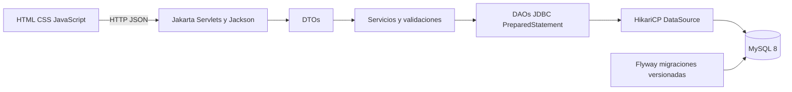
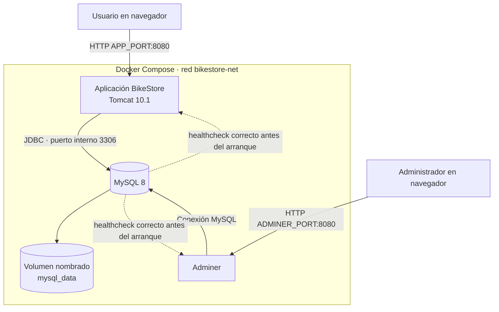
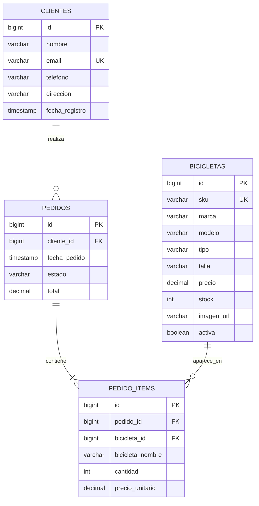

# BikeStore

Aplicación web para la práctica de **Acceso a Datos — 2.º CFGS DAM**. Gestiona bicicletas, clientes y pedidos mediante una API JSON y una interfaz responsive en español.

## Arquitectura de la aplicación



La aplicación está organizada como `webapp → controller → service → dao → MySQL`. Los Servlets sólo traducen HTTP/JSON a llamadas de servicio; los servicios validan reglas y controlan transacciones; los DAOs mapean modelos internos usando JDBC parametrizado. La API sólo expone DTOs. La creación y cancelación de pedidos bloquean la operación en una transacción y aplican/recuperan el stock mediante actualizaciones condicionales.

### Arquitectura de contenedores



Los puertos publicados de la aplicación y Adminer permiten acceder desde el equipo anfitrión; MySQL no publica ningún puerto al anfitrión y sólo recibe conexiones dentro de `bikestore-net`. `app` y `adminer` esperan a que el healthcheck de `db` indique que está saludable. El volumen nombrado `mysql_data` conserva los datos de MySQL al recrear los contenedores, salvo que se elimine expresamente con `docker compose down -v`.

### Modelo entidad-relación



`pedido_items.precio_unitario` y `pedido_items.bicicleta_nombre` conservan el precio y el nombre mostrados al comprar; `pedidos.total` se calcula en el servidor. Cada bicicleta solo puede aparecer una vez por pedido; la cantidad de líneas repetidas se consolida en el servicio. Los pedidos impiden borrar clientes o bicicletas referenciados; las bicicletas se desactivan en vez de eliminarse.

## Requisitos y puesta en marcha

- Docker Desktop con Docker Compose v2.
- Java 17 y Maven 3.9 o posterior para desarrollar fuera de Docker.

Desde la raíz del proyecto, en PowerShell:

```powershell
Copy-Item .env.example .env
```

Edita `.env` y sustituye los valores de ejemplo por contraseñas propias. Mantén `DB_NAME` y `MYSQL_DATABASE` iguales, y `DB_USER`/`DB_PASSWORD` iguales a `MYSQL_USER`/`MYSQL_PASSWORD`. `DB_POOL_MAX_SIZE`, `DB_POOL_MIN_IDLE` y `DB_CONNECTION_TIMEOUT_MS` permiten ajustar el pool Hikari; si se omiten, se usan `10`, `2` y `10000` respectivamente. El mínimo no puede superar el máximo y el timeout debe ser de al menos 250 ms. Los valores incluidos son sólo para desarrollo local: no publiques ni reutilices credenciales reales.

Arranca la aplicación:

```powershell
docker compose up --build -d
```

- Aplicación: `http://localhost:8080` (puerto configurable con `APP_PORT`).
- Adminer: `http://localhost:8081` (puerto configurable con `ADMINER_PORT`). Para iniciar sesión, selecciona el sistema MySQL y usa el servidor `db`, la base `bikestore`, el usuario `bikestore` y la contraseña `cambia_esta_clave` si no cambiaste los valores de `.env.example`. Si personalizaste `.env`, usa `DB_NAME`, `DB_USER` y `DB_PASSWORD` en su lugar. Son credenciales de demostración locales, no seguras para producción.
- MySQL sólo está accesible desde la red de Compose `bikestore-net`; los datos se conservan en el volumen nombrado `mysql_data`.

Al arrancar la aplicación, Flyway aplica las migraciones versionadas de `src/main/resources/db/migration`: la primera crea el esquema y carga datos de demostración; la segunda impide bicicletas duplicadas en las líneas de un pedido; la tercera guarda el nombre del producto en cada línea. En bases existentes, el nombre se completa con el nombre actual de la bicicleta asociada; los cambios de nombre anteriores no se pueden reconstruir retroactivamente. Los volúmenes existentes sin historial de Flyway se registran como versión inicial, por lo que se presupone que su esquema coincide con el esquema legado `V1`.

Antes de actualizar una base existente, haz una copia de seguridad y revisa posibles líneas duplicadas con esta consulta; consolídalas antes del arranque si devuelve filas, ya que la migración de unicidad se detendrá al encontrarlas:

```sql
SELECT pedido_id, bicicleta_id, COUNT(*) AS repeticiones
FROM pedido_items
GROUP BY pedido_id, bicicleta_id
HAVING COUNT(*) > 1;
```

`db/init.sql` se conserva identificado como bootstrap legado; Compose ya no lo ejecuta y Flyway es el único mecanismo de inicialización y evolución. Se mantiene el índice simple `idx_items_pedido`: las consultas de líneas filtran por `pedido_id` y ordenan por `id`, mientras que el índice único compuesto ordena por `bicicleta_id` antes del identificador y no sustituye ese orden. Para mantener los datos al reiniciar usa `docker compose down` seguido de `docker compose up -d`; no borres `mysql_data` si quieres conservarlos.

## Uso y API

La aplicación no tiene inicio de sesión ni cuentas de usuario: quien pueda acceder a la web puede utilizar sus funciones. Adminer sí presenta un formulario de acceso a la base de datos; usa las credenciales de ejemplo indicadas arriba sólo en el entorno local.

#### Manual breve

1. Abre `http://localhost:8080` y elige **Bicicletas**, **Clientes** o **Pedidos** en la navegación.
2. En **Bicicletas** o **Clientes**, usa la acción de crear para añadir un registro; abre la edición para modificarlo y confirma o cancela el formulario. Las bicicletas vinculadas a pedidos se desactivan en vez de eliminarse.
3. En **Pedidos**, consulta los pedidos y sus líneas. Para crear uno, selecciona un cliente, añade bicicletas y cantidades y confirma; el servidor calcula el total y descuenta el stock.
4. Cancela un pedido pendiente o pagado desde su acción correspondiente; al cancelarlo, el stock de sus bicicletas se restaura.

| Recurso | Operaciones |
|---|---|
| `/api/bicicletas` | `GET` listado, `POST` alta, `GET /{id}`, `PUT /{id}`, `DELETE /{id}` (desactiva) |
| `/api/clientes` | `GET` listado, `POST` alta, `GET /{id}`, `PUT /{id}`, `DELETE /{id}` |
| `/api/pedidos` | `GET` listado, `POST` creación transaccional, `GET /{id}`, `POST /{id}/cancelacion` |

Al crear un pedido se envían `clienteId` y `items` con `bicicletaId` y `cantidad`; no se aceptan precios ni totales desde el navegador. Las URL de imagen, cuando se indican, deben ser absolutas y usar `http` o `https`. Los errores de la API usan JSON y códigos HTTP semánticos: `400`, `404`, `405`, `409` y `500`; las respuestas `405` incluyen la cabecera `Allow`.

## Pruebas y compilación local

Las pruebas usan JUnit 5, Mockito y H2 en modo MySQL; crean una base en memoria independiente por prueba y no acceden a MySQL de desarrollo.

```powershell
mvn test
mvn package
```

El empaquetado produce `target/bikestore.war`. Docker compila con `maven:3.9-eclipse-temurin-17` y publica ese artefacto como `ROOT.war` en Tomcat 10.1.

## Commits y entrega

Secuencia sugerida de commits pequeños:

1. `chore: scaffold Maven WAR and Docker environment`
2. `feat: add relational schema and sample data`
3. `feat: implement bicycle and customer layers`
4. `feat: add transactional order workflow`
5. `feat: build responsive management interface`
6. `test: cover JDBC CRUD and order transactions`
7. `docs: document setup and AI workflow`

Al comprimir la entrega en `.zip`, excluye expresamente `target/` y `.git/`, además del `.env` local.